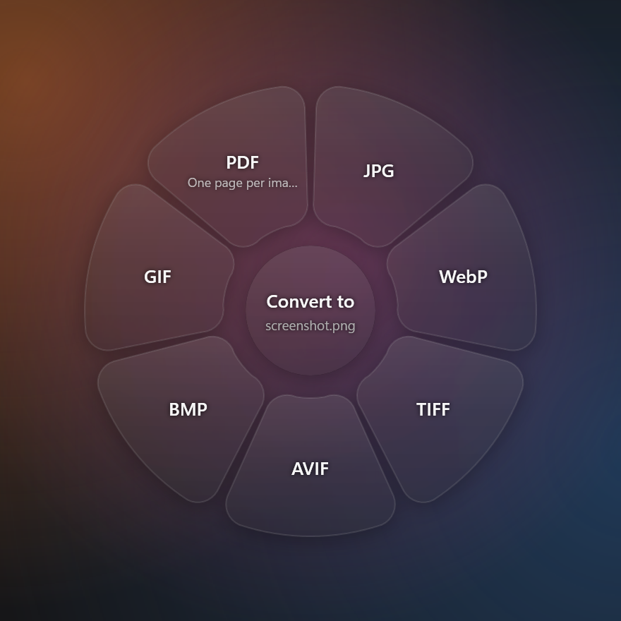

# Satsuma

**[Tangerine](https://tangerineformac.com/) for Windows.** File conversion that lives
inside the drag you were already doing.

Start dragging a file in File Explorer or on the Desktop, press **1**, and a wheel of
output formats appears under the pointer. Lean toward one, let go, and a converted copy
lands next to the original. No window, no upload, no app to open.

If you have seen Tangerine on a Mac and wanted it on Windows, this is that. It is an
independent reimplementation rather than a port — none of Tangerine's code is here, and
the two differ wherever Windows does — but the idea is Thameem's (Leap Studio), and the
gesture is meant to feel the same.



## Status

Working and usable, but early. Images, video, audio, subtitles and archives convert today,
and so do documents, spreadsheets and slides where LibreOffice is installed. PDF works
both ways: pages out as images or text, and images in.

A few conversions are in the catalogue but have no handler behind them, so they are
filtered off the wheel rather than failing after the drop: PDF to DOCX, PPTX, XLSX and
EPUB, Markdown out of documents, and HEIC output. Each is a deliberate stopping point —
see [Roadmap](#roadmap) and [limitations](docs/limitations.md).

## How it works

There are two ways in.

**Dragging.** Hold the left mouse button and start dragging, then press a number key:

| Key | Wheel | What is on it |
| --- | --- | --- |
| **1** | Convert to | Output formats for whatever you are dragging |
| **2** | Tools | Compress, resize, rotate, trim, normalise, and so on |
| **3** | Actions | Reveal, Float, Copy, Move, Copy to, Copy path, Terminal |
| **4** | — | Backs out of a question Satsuma is asking and puts the wheel back |

Then:

- **Pick a slice** by leaning toward it — the whole wedge is live, you do not have to land
  on it precisely — and release the mouse button to drop.
- **Presets** (Compress, Resize, Rotate) open a second ring. Hover one for a moment, or
  drop onto it, and the ring becomes its presets.
- **The centre** cancels. Inside a preset ring, resting there steps back out instead:
  going back has to work on hover, because the mouse button is still held and releasing
  it to click would end the drag rather than step back.
- **Esc** or **right-click** cancels outright.
- The wheel stays up after you release the key, so you can take your time.
- A key that opened a wheel does nothing more until you let go of it. Holding **1** past
  the end of a drag is the normal way to finish one, and it should not count as asking
  for a second wheel.

**Clicking.** Select a file in Explorer and press the number key, or hold the key and
then click a file. The wheel opens where you are and stays there, so you can let go of
everything and take your time. Click a slice to pick it, press 1, 2 or 3 to switch
between the wheels, click the centre to go back out of a preset ring, and click away or
press Esc to put it away.

This only arms over Explorer and the Desktop. Everywhere else a number key belongs to
whatever you are typing into.

### Where the results go

Beside the original, unless you say otherwise. Saying otherwise means holding a key
*through the end of the gesture* — it has to still be down when you let go of the mouse,
so a tap on the way past does nothing. A small mark appears on the hub while you hold it,
so you can see which one you are in before you drop.

- **Space** — somewhere else. After the drop, keep holding it and select a folder in
  Explorer; let go, and the results go into whatever folder is selected. Let go having
  selected none and Satsuma makes one, named for what it did. A label at the pointer
  says which it will be.
- **Alt** — over the original. The original goes to the Recycle Bin and the result takes
  its name. Where a delete would not reach the bin, like a network share, the original is
  kept and Satsuma says so instead of destroying it quietly.

One original that produced several files — a split — cannot have them all take its name.
The original still goes, and the pieces stay where they were written.

### Merge

Merge is on the Tools wheel for a single PDF, because one PDF is where you start: you are
looking at the first one, not at a selection.

Pick it and the wheel goes away, leaving a label at the pointer. Select the other PDFs in
Explorer the way you always would — a click takes one, **Ctrl** and **Shift** take
several — and the gesture ends when you let go of the wheel key you were already holding.
Whatever is selected at that moment is what gets merged, with the one you started from
first. If you opened the wheel by clicking rather than dragging there is no key to let go
of, so the label grows a tick to click, and **Enter** works too.

**4** backs out of any of this — the folder question, the file selection — and puts the
wheel back up, so you can pick something else. **Esc** calls the whole thing off.

### The shelf

**Float** parks files on a small glass tray in the top right that stays on top, for the case where the
source and the destination are never on screen together: park them, go and find the
folder, then drag them off. Click one to open it, drag it off to copy it somewhere,
right-click to take it off the shelf. The cross closes the tray without emptying it, and
the tray menu brings it back.

**Move** and **Copy to** both ask for a folder. Neither ever overwrites: a name that is
already taken gets " (2)". Move leaves nothing behind; Copy to leaves the original where
it was.

### Why number keys and not Shift, Ctrl and Alt

Tangerine uses modifiers, and on Windows that would be a mistake. During a drag, Explorer
reads **Shift** as move, **Ctrl** as copy and **Alt** as make-a-shortcut. Taking those over
would cost you the standard way of choosing between copy and move, which is worth more
than matching the original's key choice. Number keys do nothing during a drag — Explorer
suspends type-ahead while one is in flight — so they are free to take.

All three are rebindable; see [Settings](#settings).

## What converts

Everything below is covered by the self-test suite and verified to run.

| From | To |
| --- | --- |
| **Images** — JPG, PNG, WebP, HEIC, TIFF, AVIF, BMP, GIF, SVG\*, RAW\* | JPG, PNG, TIFF, BMP, GIF, WebP†, AVIF† |
| **Video** — MP4, MOV, MKV, WebM, AVI, WMV, and more | MP4, MOV, MKV, WebM, AVI, WMV, animated GIF, MP3 |
| **Audio** — MP3, M4A, WAV, FLAC, OGG, Opus, AIFF, WMA | MP3, M4A, WAV, FLAC, OGG, Opus, AIFF, WMA |
| **PDF** | JPG, PNG (300 dpi, one per page), TXT, Markdown |
| **Documents** — DOCX, DOC, ODT, RTF, TXT, HTML | DOCX‡, PDF‡, TXT‡, HTML‡, EPUB‡ |
| **Spreadsheets** — XLSX, XLS, ODS, CSV, TSV | XLSX‡, CSV‡, TSV‡, ODS‡, PDF‡ |
| **Slides** — PPTX, PPT, ODP | PDF‡, JPG‡, PNG‡ (one per slide) |
| **Subtitles** — SRT, VTT, ASS | SRT†, VTT†, TXT |
| **Archives / folders** | ZIP, TAR, GZIP, and Extract |

\* read only  †  needs ffmpeg  ‡  needs LibreOffice

**Tools.** Images: compress, resize, rotate, flip, grayscale, strip metadata. Video:
compress, resize, speed, rotate, remove audio, snapshot, extract audio, join. Audio:
compress, normalise, to mono, strip tags, join. PDF: merge, split, keep a page range,
compress.

**Splitting a PDF** asks where: in half, every ten pages, every page, or before page
numbers you type. One file per page is on the ring but it is not the default, because a
300-page report done that way empties itself over the folder it was sitting in and there
is no undo for 300 files. Past four pieces the results go into a new folder beside the
original instead of loose next to it, named after the page numbers inside so they sort in
reading order. **Keep pages** is the other half of the same job: a range into one new PDF,
which is what people usually mean by splitting one.

**Custom values.** Presets answer what most people want; every preset ring also has a
**Custom** slice for the value only you know. It asks after the drop, because the wheel
itself can never be typed into — taking focus would cancel the drag it lives inside.
Sizes take a percentage, a long edge or exact dimensions (`50%`, `1080`, `1200x800`), PDF
page ranges take numbers and ranges (`3-7`, `2,5,9-12`, `8-`), and split points take the
pages to cut before (`12`, `5,12,30`). What you type is checked as you type it, against
the document where that matters: a page number this PDF does not have is refused before
Enter rather than after.

The wheel only ever shows conversions that actually work on your machine. Each one is
claimed by a handler, and a format no handler can do is never drawn — so if ffmpeg or
LibreOffice is missing, the wheel is honest about it instead of failing after the drop.

### HEIC

HEIC **input** works out of the box on Windows 11, because Satsuma decodes through Windows'
own imaging stack and picks up whatever codecs are installed. HEIC **output** is not
supported: nothing shippable can write it. Compressing a HEIC gives you a JPG.

## Installing

Satsuma needs **Windows 10 1809 or later**, x64. Download the latest zip from
[Releases](https://github.com/eliasvogtenhuber/satsuma/releases), unzip it anywhere, and run
`Satsuma.exe`.

That is the whole install. The .NET runtime is in the folder, because Windows does not
ship one, and so is ffmpeg, because almost everything in video and audio needs it. The
download is about 135MB and unpacks to around 320MB.

Satsuma starts in the tray; right-click the tray icon for the menu, and tick **Start with
Windows** if you want it there permanently.

Windows will warn you the first time: the exe is not code-signed, because a certificate
costs more per year than this project is worth. **More info → Run anyway**, or check the
hash against the release if you would rather not take that on faith.

### Building it yourself

With the .NET 8 SDK:

```bash
git clone https://github.com/eliasvogtenhuber/satsuma.git
```

```bash
dotnet build Satsuma.sln -c Release
```

The app lands in `src/Satsuma.App/bin/x64/Release/net8.0-windows/`. To build the shipping
folder instead — self-contained, with ffmpeg fetched and bundled:

```bash
pwsh build/publish.ps1
```

### ffmpeg

Images that Windows can read and write need nothing. Video, audio, WebP, AVIF and the
subtitle conversions need ffmpeg, which **the release already includes** in `tools\` next
to the exe.

A build from source does not. Either run `build/publish.ps1`, which fetches it, or install
one:

```bash
winget install BtbN.FFmpeg.GPL
```

Satsuma looks in `tools\` next to the exe first, then in
`%LOCALAPPDATA%\Satsuma\tools`, then on `PATH`, then in the usual winget install
locations. The bundled copy wins on purpose: the version shipped is the version tested.
Restart Satsuma after installing one. Until it is there, those slices simply do not
appear.

### LibreOffice

Documents, spreadsheets and slides go through LibreOffice, which is the one dependency
**not** bundled: it is around 700MB, which would be three quarters of the download for
the one thing it alone can do.

```bash
winget install TheDocumentFoundation.LibreOffice
```

These are not formats worth reimplementing. A DOCX is a document model rather than a
container of text, and converting one faithfully means laying it out: pagination, styles,
tables, embedded objects. LibreOffice already does that, offline, and is the same engine
most "convert my document" websites run server-side — the difference here being that the
file never leaves the machine.

Satsuma runs it headless under its own profile, so it does not disturb a LibreOffice you
already have open, and finds it in the usual install locations or on `PATH`. The tray
menu says whether it found one.

**If you would rather keep everything in one folder**, put a copy at `tools\LibreOffice`
next to `Satsuma.exe` — the same place ffmpeg lives — and it is found there first, with
nothing installed and nothing to configure:

```
Satsuma\
  Satsuma.exe
  tools\
    ffmpeg.exe
    LibreOffice\program\soffice.exe
```

That is the whole of the bundling question. Satsuma could ship one and the download would
go from about 135MB to the better part of a gigabyte, for a corner of the app most people
never open; it could ship none and documents would quietly not work. Shipping the small
dependency, finding the large one, and leaving the door open for anyone who wants it in
the folder is the honest middle.

## Settings

`%APPDATA%\Satsuma\settings.json`, reachable from the tray menu. Changes apply on restart.

```json
{
  "FormatsKey": "1",
  "ToolsKey": "2",
  "ActionsKey": "3",
  "BackKey": "4",
  "SelectionStyle": "Depth",
  "GlassOpacity": 1.0,
  "GlassBlur": 24,
  "RevealResults": false,
  "WheelDiameter": 348,
  "RunAtLogin": false
}
```

Key names are what you would write: `"1"`, `"Space"`, `"F2"`, `"Q"`. Digits cover both the
top row and the numpad. `"Shift"`, `"Ctrl"` and `"Alt"` work too, if you want the Mac
behaviour and accept losing Explorer's copy/move for the duration of a drag.

**Appearance.** `GlassOpacity` biases how solid the glass is: 1 is the default, lower is
more see-through, higher is more opaque. It is a multiplier rather than a fixed opacity
because Satsuma already measures what the wheel is covering and tints to suit, so one flat
value would be too heavy over a dark desktop and too light over a white document.
`GlassBlur` is the backdrop blur radius. `SelectionStyle` is `Depth` (the frost under the
chosen slice goes softer) or `Density` (it thickens into a brighter pane).

`RevealResults` opens Explorer on the results of every job. It is off because results land
next to the original, which is usually the folder you were already looking at — click the
progress card to reveal them instead.

## When a drag does nothing

Start Satsuma with `--debug` and it writes a trace to
`%LOCALAPPDATA%\Satsuma\satsuma.log`. The interesting half of Satsuma runs inside global
input hooks during another app's modal drag loop, where there is no window to print to and
nothing to attach a debugger to, so the log is the way to see which link broke:

```
hooks installed: mouse=True, keyboard=True
bound keys: 0x31=Formats, 0x61=Formats, 0x32=Tools, ...
button down at 1440,810
drag detected
bound key 0x31 -> Formats, dragging=True
wheel requested: Formats at 1675,928
showing Formats wheel, seed=1 file(s)
```

If `drag detected` never appears, the pointer never passed the drag threshold. If a bound
key is seen with `dragging=False`, the key arrived before Satsuma judged a drag to have
started. If nothing appears at all, the drag began in an elevated window; see
[limitations](docs/limitations.md).

## Startup

Satsuma builds and renders the wheel once when it starts, off-screen and invisible. The
first time WPF realises that window it costs around a second -- creating it, loading
fonts, compiling the blur, setting up a layered surface -- and none of that work depends
on what is being dragged. Paid at startup it is invisible; paid on the first drag it was a
second of lag at exactly the wrong moment. Afterwards a wheel opens in about 40ms.

## Running the tests

```bash
dotnet run --project tests/Satsuma.SelfTest -c Release
```

The self-test covers the wheel's hit testing as pure geometry, then generates sample
files and drives the real engine over them, checking that a
resize really halves the pixels, that a rotate really swaps the axes, that compressing
really shrinks the file, and that the wheel hides what it cannot do. It skips the ffmpeg
half cleanly when ffmpeg is absent. The drag itself cannot be scripted, so everything
behind it is covered here instead.

## How it is put together

```
src/Satsuma.Core/     Engine: catalogues, handlers, ffmpeg and WIC plumbing. No UI.
src/Satsuma.App/      Tray app: input hooks, the wheel, progress, shelf, actions.
tests/Satsuma.SelfTest/   Drives the engine over generated files.
```

Three pieces do the interesting work:

**Noticing the drag.** Windows has no API for "is a drag in flight", and the drag source
sits in a modal loop inside whichever app started it. Low-level input hooks still fire
during that loop, so Satsuma infers a drag the way the shell itself does — left button
down, pointer past the system drag threshold — and treats a bound key pressed during one
as a request for a wheel.

**Catching the drop.** The wheel is a transparent, topmost window that is never activated,
which is what keeps the drag alive: taking focus would cancel it. It is painted only where
it means to catch something, so the OS routes the drag to Satsuma inside the circle and to
whatever is underneath outside it.

**Knowing what you are dragging.** The wheel has to appear the instant you press the key,
but the dragged paths only arrive when the pointer reaches the window. So Satsuma reads
the selection straight out of the Explorer view the drag started in, and treats it as a
guess — the real paths replace it on the way in, which is also what makes drags from
anywhere else work.

## Roadmap

- PDF to DOCX, PPTX and XLSX, which is layout reconstruction rather than conversion
- PDF to EPUB
- Markdown out of documents, which LibreOffice has no export filter for
- Multi-image collages
- Crop, annotate and redact, which need an editor surface rather than a wheel
- Trim and split for video and audio, which need the same
- The Windows share sheet, Tangerine's AirDrop slice — it is WinRT and wants a focused
  window to anchor to, which the wheel deliberately is not

## Credits

Inspired by [Tangerine](https://tangerineformac.com/) by Thameem / Leap Studio. If you are on a
Mac, buy theirs.

## Licence

MIT — see [LICENSE](LICENSE).

Satsuma bundles the .NET runtime and ffmpeg, and builds on PdfPig and Docnet. What is in
the release zip and under what terms is in
[THIRD-PARTY-NOTICES.md](THIRD-PARTY-NOTICES.md).
